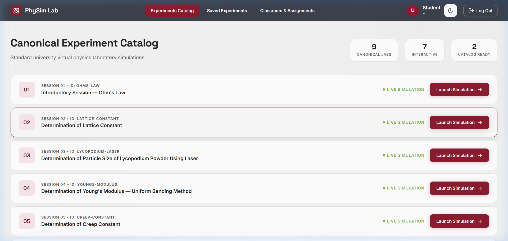
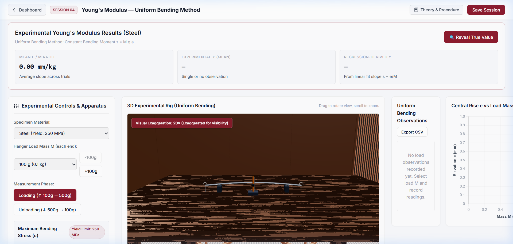
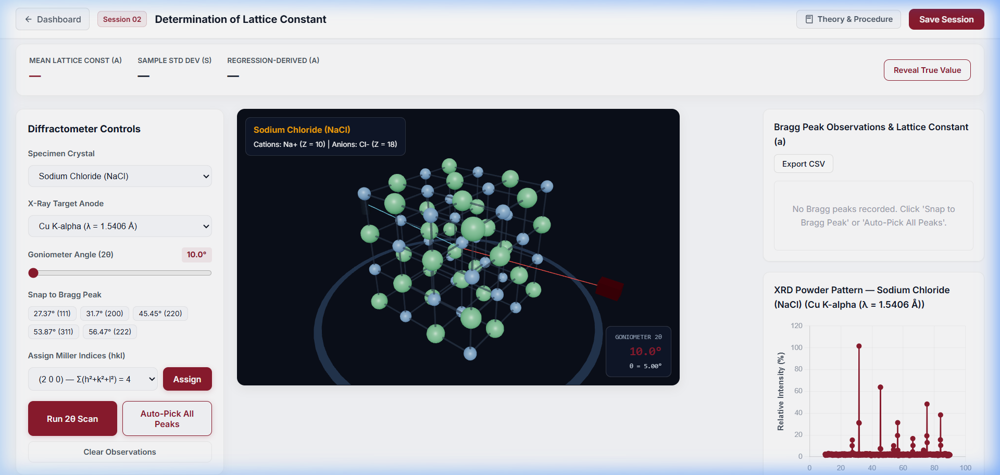
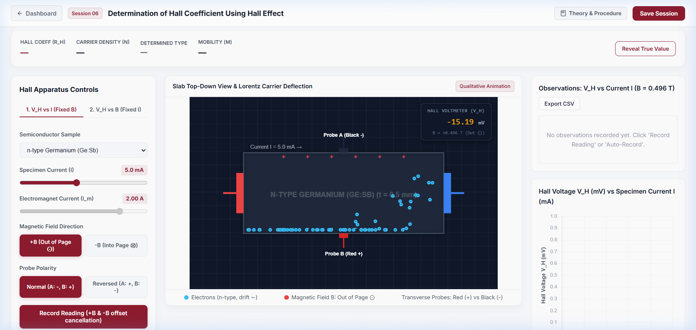
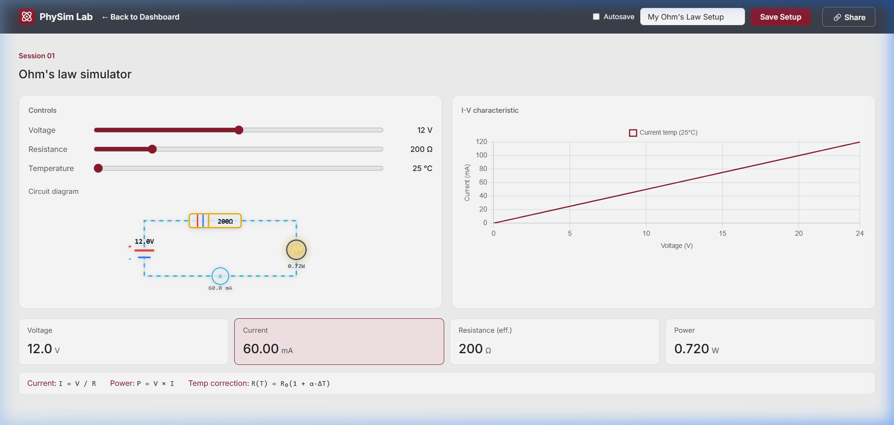

<div align="center">

# ⚛️ 3D Physics Virtual Laboratory (PhySim)

<p align="center">
  <strong>An interactive, photorealistic, web-based physics laboratory featuring 3D Three.js/WebGL simulations, real-time wave optics & carrier drift canvases, live regression charting, and a Spring Boot + PostgreSQL backend.</strong>
</p>

<p align="center">
  
  
  
  
  
  
  
</p>

---

### 🌐 Live Dashboard Overview


</div>

---

## 🌟 Key Highlights

- **Interactive 3D Environments**: Built with `@react-three/fiber` & `@react-three/drei`. Features realistic beam bending under progressive weights, dynamic travelling microscope vernier scales, and $3\times3\times3$ crystal lattices with rotating goniometers and Bragg reflection planes.
- **Dynamic 2D Wave & Carrier Transport Canvases**: High-frequency carrier drift with qualitative Lorentz force deflections, circular Bessel Airy diffraction patterns, and live circuit current animations with incandescent filament glowing.
- **Shared Laboratory Kit**: Standardized observation tables with client-side **CSV export**, real-time **Chart.js linear regressions** with $R^2$ goodness-of-fit, and theory/procedure slide-out drawers.
- **Enterprise Spring Boot Backend**: Robust Java 21 REST API with **PostgreSQL** persistence, Flyway versioned migrations (`V1`–`V3`), MFA login (TOTP & WebAuthn), and cryptographic tokenized experiment sharing.
- **Zero-Friction Dev Auth Bypass**: Offline development bypass mode for local simulation testing without login friction.

---

## 📸 Simulation Gallery

<div align="center">

### 1. Young's Modulus by Uniform Bending (Session 04)
*Real-time beam deformation, stacked brass slotted weights, and dual-scale travelling microscope.*



---

### 2. Lattice Constant by Bragg Diffraction (Session 02)
*3D cubic rock-salt lattice (NaCl, KCl, LiF), rotating goniometer detector arc, and peak snapping spectrum.*



---

### 3. Hall Coefficient & Carrier Mobility (Session 06)
*Top-down carrier drift canvas, qualitative Lorentz force deflection, magnetic field reversal, and digital voltmeter widget.*



---

### 4. Verification of Ohm's Law (Session 01)
*Dynamic animated current flow with moving electron pulses, live ammeter, and temperature-dependent resistance.*



</div>

---

## 🔬 Curriculum Catalog & Scientific Formulas

| Session | Experiment Name | Key Physics Formulae | Interactive Environment |
|---|---|---|---|
| **01** | **Verification of Ohm's Law** | $$V = I \cdot R, \quad P = V \cdot I, \quad R(T) = R_0(1 + \alpha \Delta T)$$ | **2D Animated Circuit** with moving electron stream |
| **02** | **Lattice Constant by Bragg Diffraction** | $$2 d_{hkl} \sin\theta = n \lambda, \quad d_{hkl} = \frac{a}{\sqrt{h^2+k^2+l^2}}, \quad a = \frac{\lambda \sqrt{h^2+k^2+l^2}}{2 \sin\theta}$$ | **3D R3F Crystal Scene** with goniometer scan |
| **03** | **Particle Size via Lycopodium Laser** | $$\sin\theta_n = \frac{k_n \lambda}{d}, \quad r_n \approx D \tan\theta_n \approx \frac{D k_n \lambda}{d}$$ | **2D Airy Wave Canvas** with ring overlays |
| **04** | **Young's Modulus by Uniform Bending** | $$y = \frac{m g a l^2}{8 Y I_g}, \quad I_g = \frac{b d^3}{12}, \quad Y = \frac{3 g a l^2}{2 b d^3} \cdot \left(\frac{m}{y}\right)$$ | **3D Bending Rig** with travelling microscope |
| **05** | **Torsional Pendulum & Creep Constant** | $$T = 2\pi \sqrt{\frac{I}{C}}, \quad C = \frac{\pi \eta r^4}{2 l}, \quad \beta = \frac{\Delta l / l_0}{t^{1/3}}, \quad k = \frac{\Delta l / l_t}{t}$$ | **3D Physics Rig** with physical wire elongation |
| **06** | **Hall Effect & Carrier Mobility** | $$V_H = \frac{R_H I B}{t}, \quad R_H = \frac{1}{n q}, \quad n = \frac{1}{\|R_H\| q}, \quad \mu = \|R_H\| \sigma$$ | **2D Carrier Canvas** with digital voltmeter |
| **07** | **Planck's Constant via Photoelectric Effect** | $$e V_0 = h \nu - \Phi = \frac{h c}{\lambda} - \Phi, \quad h = \frac{e}{c} \cdot \frac{d V_0}{d (1/\lambda)}$$ | **Optical Bench** with wavelength selectors |
| **08** | **Solar Cell Characteristics** | $$I = I_{ph} - I_0 \left[\exp\left(\frac{q(V+I R_s)}{n k_B T}\right) - 1\right], \quad FF = \frac{P_{max}}{V_{oc} I_{sc}}$$ | **Photovoltaic Setup** with illuminance knobs |
| **09** | **Laser Wavelength via Diffraction Grating** | $$d \sin\theta = n \lambda, \quad d = \frac{1}{N}, \quad \lambda = \frac{d \sin\theta_n}{n}$$ | **2D Multi-Slit Canvas** with spot measuring |

---

## 🛠️ Technology Stack

```
3D-Physics-Lab/
├── apps/
│   ├── frontend/            # React 19, TypeScript, Vite, Three.js, Chart.js
│   │   ├── src/
│   │   │   ├── components/  # LabShell, ChartPanel, DataTable, useExperimentSave
│   │   │   ├── experiments/ # 9 Modular Physics Simulation Packages
│   │   │   │   ├── ohmsLaw/
│   │   │   │   ├── latticeConstant/
│   │   │   │   ├── lycopodiumLaser/
│   │   │   │   ├── youngsModulus/
│   │   │   │   ├── creepConstant/
│   │   │   │   ├── hallEffect/
│   │   │   │   ├── laserGrating/
│   │   │   │   └── registry.ts
│   │   │   ├── pages/       # Dashboard, Saved, Shared, Auth Pages
│   │   │   └── lib/         # Stats & PRNG Engine (mean, regression, noise)
│   └── backend/             # Java 21, Spring Boot 3.4, Spring Security, JPA
│       ├── src/main/java/   # Controllers, Entities, Repositories, Services
│       └── src/main/resources/db/migration/ # Flyway SQL Schema Migrations (V1-V3)
└── docs/screenshots/        # Demonstration screenshots and figures
```

---

## 🚀 Quickstart & Setup (Windows PowerShell)

### 1. Prerequisites
- **Java 21 (JDK)** (e.g. Eclipse Temurin)
- **Apache Maven 3.9+**
- **Node.js 20+ / 24+**
- **PostgreSQL 14+** on port `5432`

### 2. Database Setup
```powershell
# Create the PostgreSQL database
psql -U postgres -h localhost -p 5432 -c "CREATE DATABASE physim;"
```

### 3. Environment Variables
```powershell
$env:SPRING_PROFILES_ACTIVE = "local"
$env:DATABASE_URL = "jdbc:postgresql://localhost:5432/physim"
$env:DATABASE_USERNAME = "postgres"
$env:DATABASE_PASSWORD = ""
$env:SESSION_SECRET = "dev_secret_cookie_signing_key_at_least_32_chars_long!"
$env:INITIAL_ADMIN_PASSWORD = "AdminPassword123!"
$env:GOOGLE_CLIENT_SECRET = "dev-fake-google-client-secret"
```

### 4. Running the Laboratory Locally
```powershell
# Install frontend dependencies
npm install

# Start Spring Boot Backend (Port 8080)
npm run dev:backend

# In a separate terminal, start Vite Frontend Dev Server (Port 5173)
npm run dev:frontend
```

Visit the application at: **`http://localhost:5173`**

---

## 🧪 Automated Testing

### Frontend Test Suite (Vitest)
```powershell
npm run test:frontend
```
```
✓ 12 test files passed (12)
✓ 90 tests passed (90)
  - Unit benchmarks for all 9 simulation physics calculations
  - Slider min/max range sweep tests (guaranteeing 0 NaN or Infinity)
  - Type guard validation for saved states (< 20 KB JSON contract)
```

### Backend Test Suite (Maven)
```powershell
npm run test:backend
```
```
[INFO] Tests run: 41, Failures: 0, Errors: 0, Skipped: 0
[INFO] BUILD SUCCESS
  - JPA repository integration tests
  - Spring Security & session cookie tests
  - OAuth flow and MFA challenge validation
```

---

## 👥 Authors & License

Developed for the **Virtual Physics Laboratory (PhySim)**.  
Released under the [ISC License](LICENSE).
